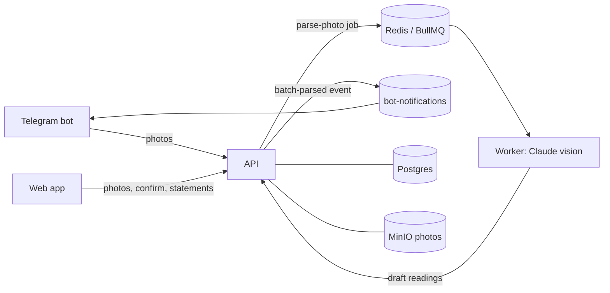

# Rental Manager

Utility billing for my rental apartments. Tenants send photos of their meters; an LLM worker reads the values, I
confirm them, and the app calculates the monthly utility charge added to the rent.

It is a real tool I use every month and a pet project for learning to build with
[Claude Code](https://claude.com/claude-code): planning, rules and issues for the agent live in this repo too.

## How it works



1. A photo arrives — uploaded in the web app or forwarded to the Telegram bot (an album = one batch).
2. The API stores it and queues a parse job. Photos without an apartment go to the **inbox**: the worker finds the
   apartment by the meter's serial number.
3. The worker reads the values (LangChain.js + Claude vision), matches them to meters and saves them as **drafts**.
4. A human confirms each draft — in the web app or with a button in Telegram. Parsed values are never used before
   that.
5. A monthly **statement** = consumption × the tariff valid for the period, per utility, + fixed fees + rent.

The API is the only way to the data and business rules; the web app, the worker and the bot are its HTTP clients.

## Features

- Apartments, tenants and leases (open-ended allowed; never overlapping)
- Meters: electricity (single or day/night), cold and hot water, gas; replacement with initial/final readings
- Readings: draft → confirmed or cancelled; values only grow; photo kept for every value
- Photo inbox with apartment detection by meter serial number
- Warnings for unusual consumption
- Tariffs with price history, fixed fees, per-apartment overrides, manual amounts
- Monthly statements as snapshots, money in integer kopiyky (UAH)
- Telegram bot: forward photos, get the parse result, confirm with a tap (owner only)

## Stack

| Part                   | Tech                                                      |
| ---------------------- | --------------------------------------------------------- |
| `apps/api`             | NestJS, Prisma, Postgres, MinIO (S3), BullMQ              |
| `apps/web`             | Next.js, React, Tailwind, shadcn/ui                       |
| `apps/worker`          | NestJS standalone, BullMQ, LangChain.js + Claude (vision) |
| `apps/bot`             | NestJS standalone, grammY (long polling), BullMQ          |
| `packages/shared`      | Shared rules and the BullMQ contracts                     |
| Infra (Docker Compose) | Postgres, MinIO, Redis                                    |

pnpm workspaces monorepo, TypeScript everywhere, Node 24.

## Getting started

Requirements: Node 24 (`.nvmrc`), pnpm via corepack, Docker.

```bash
corepack enable
cp .env.example .env          # local defaults; secrets below are optional
pnpm install
pnpm infra:up                 # Postgres :5433, MinIO :9000 (console :9001), Redis :6379

pnpm --filter api db:migrate:deploy
cp apps/api/prisma/seed-users.example.json apps/api/prisma/seed-users.json   # edit: your email + password
pnpm --filter api seed

pnpm dev:api                  # http://localhost:3001/api, Swagger at /docs
pnpm dev:web                  # http://localhost:3000
```

There is no sign-up: users come from the seed file (`seed-users.json` is gitignored).

### Switching to the pgvector image

Postgres runs on `pgvector/pgvector` (pinned in `docker-compose.yml`; was `postgres:18-alpine`). The data volume is
reused as is, but Alpine (musl) and Debian (glibc) sort text differently, so text indexes built under Alpine must be
rebuilt — in every database, including `postgres` and `template1` (new databases, e.g. Prisma's shadow DB, are copied
from it). Once per existing dev DB (a fresh volume needs none of this):

```bash
set -a; source .env; set +a   # POSTGRES_USER / POSTGRES_DB for the commands below

# 1. Backup only — while the old container is still running. -T: no TTY (it would corrupt the binary dump).
#    Outside the repo: the dump holds real data.
docker compose exec -T postgres pg_dump -U "$POSTGRES_USER" -Fc "$POSTGRES_DB" > ~/rental-backup.dump

# 2. Recreate the container on the new image (same volume), wait until it is healthy
pnpm infra:down && docker compose up -d --wait

# 3. In every database that accepts connections: rebuild indexes; refresh the recorded collation version where
#    there is one (Alpine records none — NULL — so after this switch only REINDEX runs; there is no warning to clear)
for db in $(docker compose exec -T postgres psql -U "$POSTGRES_USER" -d postgres -Atc \
  "SELECT datname FROM pg_database WHERE datallowconn"); do
  docker compose exec -T postgres psql -U "$POSTGRES_USER" -d "$db" -v ON_ERROR_STOP=1 <<'SQL'
SELECT format('REINDEX DATABASE %I', current_database()) \gexec
SELECT format('ALTER DATABASE %I REFRESH COLLATION VERSION', current_database())
  FROM pg_database WHERE datname = current_database() AND datcollversion IS NOT NULL \gexec
SQL
done

# 4. Apply pending migrations (installs the vector extension)
pnpm --filter api db:migrate:deploy
```

### Photo parsing (worker)

Needs an Anthropic API key and an API key for the worker's service user:

```bash
pnpm --filter api apikey:create --service worker --name local \
  --scopes photos:read,meters:read,readings:create-draft,photos:parse-result,condition-photos:read,condition-photos:describe
```

Put the printed key into `WORKER_API_KEY`, set `ANTHROPIC_API_KEY`, then `pnpm dev:worker`.

### Telegram bot (optional)

Create a bot with [@BotFather](https://t.me/BotFather), put its token into `TELEGRAM_BOT_TOKEN` and your Telegram
user id into `TELEGRAM_ALLOWED_USER_IDS` (everyone else is ignored). Then:

```bash
pnpm --filter api apikey:create --service telegram-bot --name local \
  --scopes photos:upload,photos:read,apartments:read,readings:read,readings:confirm,readings:cancel,photos:assign
```

→ `BOT_API_KEY`, then `pnpm dev:bot`. One running process per bot token.

### MCP server (read-only)

The MCP server for Claude Desktop reads data with its own key: read scopes plus `statements:preview`, which
calculates a statement without saving it. API keys never see tenant data.

```bash
pnpm --filter api apikey:create --service mcp --name "claude-desktop" \
  --scopes apartments:read,meters:read,readings:read,statements:read,tariffs:read,statements:preview
```

Put the key in the root `.env` as `MCP_API_KEY` (next to `API_BASE_URL`, see `.env.example`), build with
`pnpm --filter mcp build`, and have the API running (`pnpm dev:api`). The server reads its env from
`apps/mcp/.env` if that exists (an optional override), else from the root `.env`; values the client passes in `env`
win over both.

**Claude Code** (main way): the committed `.mcp.json` at the repo root starts `node apps/mcp/dist/main.js`, with no
key in it. Open the repo in Claude Code, approve the `rental-manager` server, and check `/mcp`.

**Claude Desktop** (alternative): add it to `claude_desktop_config.json` (Settings → Developer → Edit Config) with an
absolute path and restart Claude Desktop. `env` is optional (the root `.env` is found from the script's location):

```json
{
  "mcpServers": {
    "rental-manager": {
      "command": "node",
      "args": ["/absolute/path/to/rental-manager-app/apps/mcp/dist/main.js"]
    }
  }
}
```

**Logs**: every tool call is one line on stderr (`[rental-mcp] tool get_statement {…} → ok 142ms`), which the
client keeps in its MCP logs (Claude Desktop: `mcp-server-rental-manager.log`). To follow them live, set
`MCP_LOG_FILE` in the `.env` (an absolute path, or relative to the repo root whatever the client's cwd; the directory
is created), e.g. `MCP_LOG_FILE=logs/mcp.log`, and `tail -f logs/mcp.log`. Logs never contain the key or response bodies.

Debug it without a client in the MCP Inspector (a browser UI: list the tools, call them, see stderr):

```bash
npx @modelcontextprotocol/inspector node apps/mcp/dist/main.js
```

`pnpm dev` starts everything at once.

## Commands

| Command                                               | What                                            |
| ----------------------------------------------------- | ----------------------------------------------- |
| `pnpm dev`                                            | shared + api + web + worker + bot               |
| `pnpm dev:api` / `dev:web` / `dev:worker` / `dev:bot` | one app                                         |
| `pnpm infra:up` / `infra:down` / `infra:logs`         | Docker Compose infra                            |
| `pnpm test` · `pnpm lint` · `pnpm build`              | all workspaces                                  |
| `pnpm format` / `pnpm format:check`                   | Prettier                                        |
| `pnpm gen:api`                                        | OpenAPI → typed clients for web, worker and bot |
| `pnpm --filter api db:migrate`                        | create + apply a migration (dev)                |
| `pnpm prisma:studio`                                  | browse the database                             |

## Scripts and CLIs

Manual tools, run from the repo root. They build first, then run once.

| Command                                                                                 | What                                                                               |
| --------------------------------------------------------------------------------------- | ---------------------------------------------------------------------------------- |
| `pnpm --filter worker describe:samples -- samples/condition`                            | condition photos in a folder → the model's descriptions (**paid**, 1 call / photo) |
| `pnpm --filter worker extract:samples -- samples [--inbox]`                             | meter photos in a folder → the model's readings (**paid**, 1 call / photo)         |
| `pnpm --filter api apikey:create --service <s> --name <n> --scopes <a,b>`               | API key for a service (worker, bot, MCP); `apikey:list`, `apikey:revoke <prefix>`  |
| `pnpm --filter api embed:backfill`                                                      | embed described condition photos that have no vector yet (Voyage)                  |
| `pnpm --filter api search:debug -- --apartment <id\|name> "<query>"`                    | condition photo search: vector and rerank scores side by side                      |
| `pnpm --filter api describe:requeue -- --apartment <id\|name> \| --all \| --photo <id>` | describe condition photos again (worker: **paid**, 1 call / photo)                 |

Samples folders, `expected.json` and the output: [`apps/worker/README.md`](apps/worker/README.md#samples-scripts--check-the-model-on-local-photos).

## Repository layout

```
apps/
  api/        NestJS API — the only way to data and business rules
  web/        Next.js UI (mobile-first, Ukrainian)
  worker/     photo parsing and condition photo descriptions (BullMQ consumer) — README.md
  bot/        Telegram bot
packages/
  shared/     shared rules (consumption limits, phone normalization) + queue contracts
.claude/
  rules/      path-scoped instructions for Claude Code, per app and area
  skills/     /issue — implement a GitHub issue end to end
CLAUDE.md     project context for Claude Code (domain, rules, commands)
```

## Working with Claude Code

- `CLAUDE.md` (root and per app) is the project context; `.claude/rules/<app>-<area>.md` add details per area and
  load only when files of that area are touched.
- Work is planned as GitHub issues (epics with sub-issues). In Claude Code, `/issue <N>` reads the issue, plans,
  implements on a branch and opens a PR.
- Every change lands through a PR.
